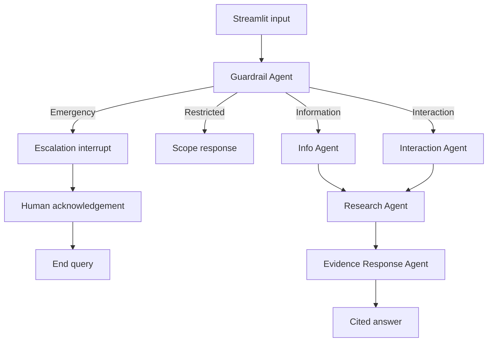
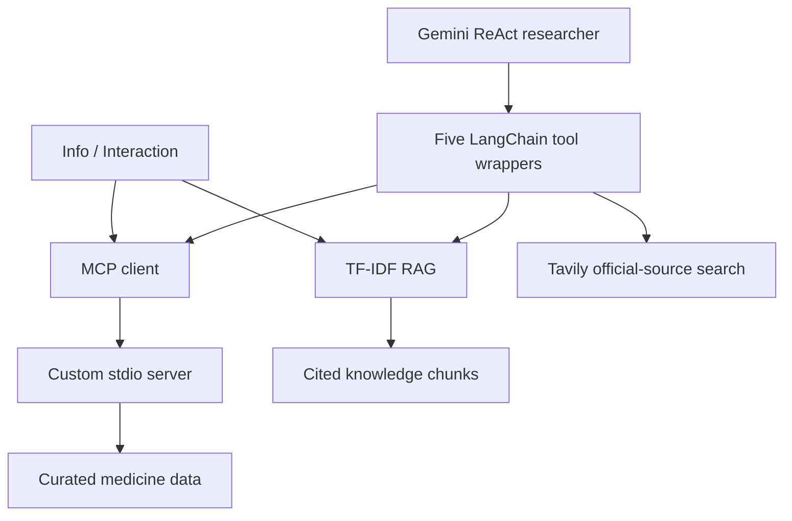

# Architecture

The ReAct loop performs model → tool call → observation → model, with at most four model turns. The outer LangGraph runs with a recursion limit of 15 in the UI. MCP transport timeout is 35 seconds; Gemini has a per-call timeout of 30 seconds and no retries; Tavily timeout is 20 seconds. No external calls are required after package installation in Offline demo.
